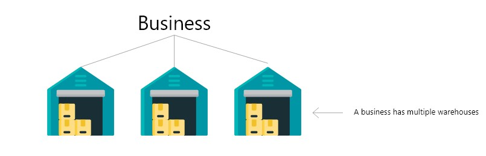
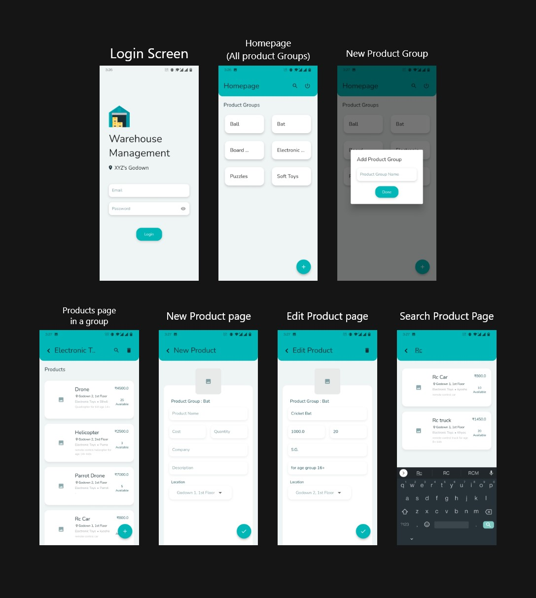

# Warehouse Management System 🏬

A modern, full-featured **Warehouse & Inventory Management Application** built with **Flutter** and powered by **Firebase Cloud Firestore & Authentication**. Designed to track inventory across multiple warehouses, organize products into categories/groups, locate stock across godowns/floors, and perform real-time searches.

---

## 🌟 Key Features

- **Multi-Warehouse & Group Architecture**:
  - Structured inventory hierarchy with nested product groups.
  - Dedicated `/warehouse/{warehouseId}/` collection schema in Cloud Firestore.
- **Real-Time Inventory Tracking**:
  - Live stock level updates, cost tracking (in ₹), and godown/floor location tagging.
- **Product Management**:
  - Add, update, and delete products with image previews, stock availability, and manufacturer information.
- **Instant Search**:
  - Real-time global search across all warehouse inventory and targeted search within specific product groups.
- **Cross-Platform Support**:
  - Fully responsive on **Web** and **Mobile** (Android & iOS).
- **Dual Mode (Frontend Demo & Live Firebase)**:
  - Run offline in Standalone Frontend Demo mode or connect seamlessly with live Firebase Firestore.

---

## 📸 Screenshots & Architecture





---

## 🛠️ Tech Stack

- **Frontend**: Flutter 3.x, Dart
- **Backend / Database**: Google Firebase Cloud Firestore
- **Authentication**: Firebase Auth (Email/Password & Demo Mode)
- **UI & State**: Responsive Material Design, Custom Color Palette, Reactive Streams

---

## 🚀 Getting Started

### Prerequisites

- [Flutter SDK](https://docs.flutter.dev/get-started/install) (version `>= 2.18.0`)
- Google Chrome (for web) or an Android/iOS emulator

### Installation

1. **Clone the repository**:
   ```bash
   git clone https://github.com/subbham829584/warehouse_management.git
   cd warehouse_management
   ```

2. **Install dependencies**:
   ```bash
   flutter pub get
   ```

3. **Run on Web**:
   ```bash
   flutter run -d chrome
   ```

4. **Run on Android / Desktop**:
   ```bash
   flutter run
   ```

---

## ⚙️ Firebase Setup

The app is pre-configured to connect to Firebase.
- Firebase credentials can be found in `lib/firebase_options.dart`.
- Firestore collections are rooted at `/warehouse/{warehouseId}/` with subcollections:
  - `product_groups`: Stores product category documents.
  - `products`: Stores individual product item documents.

---

## 👤 Author

- **Subham** - [@subbham829584](https://github.com/subbham829584)

---

## 📄 License

This project is licensed under the MIT License - see the [LICENSE](LICENSE) file for details.